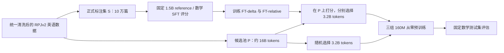

实验计划：数学 SFT loss-drop → fastText → 160M 预训练
===================================================

版本：2026-11-02，用户已批准执行，正式标注集改为 100,000 篇。数学目标、现有 1.5B 评分模型、fastText 路线、绝对与相对下降量并列、160M / 3.2B tokens 和三个实验臂均按本方案执行。实际进度与结果由运行产物记录。

本轮要回答：在相同数据来源、模型初始化、训练配方和 token 预算下，用数学 SFT 前后的 loss 下降量产生 fastText 标签，是否能选出使最终 160M 模型数学 loss 更低的数据。论文提供数据来源参考；选数信号和实验对照围绕这个问题设计。

**本版建议冻结的参数**

| 项目 | 本版设置 | 状态 |
| --- | --- | --- |
| 评分模型 | Qwen2.5-1.5B-Instruct reference 与现有数学 SFT step 64 | 已确认沿用 1.5B；复用旧实验这对权重 |
| 正式标注集 S | 100,000 篇完整文档 | 用户已确认，直接用于 fastText 训练与验证 |
| 分类器数据划分 | 按域名与近重复组划分，约 80% / 10% / 10% | 建议默认值；两个分类器共享划分 |
| 正式候选池 P | 约 16B Pythia tokens，与 S 的文档/近重复组隔离 | 建议默认值；三个实验臂共享 |
| include 标签 | 各自指标在训练部分中累计前约 20% tokens 的文档 | 建议默认值；两个阈值分别冻结 |
| 分类器 | FT-delta、FT-relative | 已确认只使用两种 loss 变化信号 |
| 预训练 | Pythia 160M 架构，从零训练，每组 3.2B 有效预测 tokens | 已确认规模与预算 |
| 实验臂 | Random、FT-delta、FT-relative | 已确认 |
| 首轮 / 后续 seeds | 首轮 42；后续补 43、44 | 建议先交付三次完整训练，再补到九次 |
| 最终目标评估 | MATH 官方 test 的独立题组，解答 NLL 为主要观测量 | 建议默认值；在看结果前冻结 |

**执行流程**



1. **准备统一的数据来源与互相隔离的集合。**

   使用 [togethercomputer/RedPajama-Data-V2](https://huggingface.co/datasets/togethercomputer/RedPajama-Data-V2) 的 `sample-100B` 英语部分。固定 revision `aa033f6b6480c445557e9118283993403f069f6a`、源 shard 清单、数据处理代码和抽样 seed。上游 sample 配置会强制使用五种语言与 `head_middle`，英语筛选需落实在文件清单或读入后的过滤；“100B” 是上游名称，实际规模重新计数。

   全部数据执行相同的正文有效性检查、英语筛选、精确/近重复处理和目标题目重合排查。正文保留公式及 LaTeX；不根据数学关键词或人工质量标签额外挑选。用固定内容哈希/文档 ID 抽样，避免只取流式数据开头。建议固定 `data_seed=20261102`，用于数据划分和候选池抽样；分数边界另用 `label_tie_seed=20261103`，不依赖文档来源顺序。

   从清洗后的统一来源划出 S：10 万篇正式标注文档。按注册域名（eTLD+1）分组，并约束同一近重复组不跨集合，将 S 划分为训练、开发、留出部分，文档量尽量接近 8 万 / 1 万 / 1 万。以组边界为准，记录实际数量。两个分类器使用完全相同的文本与划分。

   将 S 及其近重复组排除后，固定约 16B Pythia tokens 作为 P。三个预训练实验臂都从 P 取数。另固定约 1 万篇与 S/P 隔离的 RPJv2 文档，用作辅助的通用文本 NLL 评估；它不构成额外预训练实验臂。

   数学 SFT 训练题、旧验证题及最终数学测试题与 S/P 做统一的重合排查；疑似重合整组隔离，并记录原因。保存文档 ID、正文哈希、来源、域名、crawl、去重组、各 tokenizer 的 token 数。S 用于正式分类器训练，不设额外的独立评分预实验。

   交付：数据清单、S 的固定划分、P 清单、评估清单、实际文档/token 统计与去重报告。

2. **使用固定的 1.5B 模型对 S 正式评分。**

   Reference 为 `Qwen/Qwen2.5-1.5B-Instruct`，revision `989aa7980e4cf806f80c7fef2b1adb7bc71aa306`。SFT 使用旧项目七类 MATH、4,096 条训练样本、64 步后的固定 checkpoint。已核对持久化位置及完成标记：

   `/mnt/tianzhu_hot/data-picking/runs/math-web-probe-qwen25-1p5b-n4096-b64-s64-seed42/checkpoints/step-000064-a96c8e03`

   两模型各对 S 运行一次，结果同时用于两种指标。沿用经过旧实验检查的 FP32 forward、SDPA math，`eval()` / no-grad；H100 执行 batch 为 16，写正式分数前对照单样本验证 2e-5 的 NLL 容差。网页输入是原始正文。固定 Qwen tokenizer，把长文档切成最多 2,048 tokens 的窗口，相邻窗口共享一个上下文 token；文档第一个 token 之外的正文 token 每个评分一次。两模型的 token IDs、窗口和 mask 完全一致。

   对每篇文档先累加窗口 NLL 总和，再除以实际评分 token 数，得到平均 NLL：

   ```text
   L_ref(d)       = reference 的文档平均预测 token NLL
   L_sft(d)       = 数学 SFT 模型的同口径 NLL
   delta_loss(d)  = L_ref(d) - L_sft(d)
   relative_gain = delta_loss(d) / max(L_ref(d), 1e-6)
   ```

   两种分数均固定为越大越优，绝对下降量指平均 token loss 的差。记录分母保护触发数、非有限值与覆盖率。评分按 shard 保存原始 loss、token 数、分数及权重/输入指纹，可跳过已验证完成的 shard。1.5B 评分只覆盖 S；P 的全量评分由 fastText 完成。

   交付：逐文档 `label_scores.parquet` 和完整的评分配置/覆盖校验。

3. **生成标签，训练两个 fastText。**

   在 S 的训练部分，对两种指标分别排序，以 Pythia 文档 token 数为权重，取累计约 20% tokens 对应的高分文档为 `include`，其余为 `exclude`。以完整文档为标签单位，边界同分用预先固定的哈希顺序处理，记录越界文档及实际 token 比例。分别保存两个截止分数和边界规则。

   对 S 的开发/留出部分直接应用训练部分确定的截止规则，不在这些集合重新调成 20% 正例。`include` 表示相对高分，并不保证该文档的 delta 为正；报告截止分数、正 delta 占比和正负类的文档/token 数。

   | 分类器 | 标签来源 | 输入 |
   | --- | --- | --- |
   | FT-delta | `delta_loss` 的 include / exclude | 文档正文 |
   | FT-relative | `relative_gain` 的 include / exclude | 同一批文档正文 |

   初始配方建议统一使用有监督 softmax：`wordNgrams=2`、`dim=100`、`lr=0.1`、`epoch=5`、`minCount=1`、`bucket=2000000`，关闭字符子词（`minn=0,maxn=0`），固定输入顺序和 `ft_seed=20261104`。首轮采用单线程训练以固定更新顺序；候选池推理可按 shard 并行。包版本和实际参数全部落盘，首轮不为两个指标分别搜索超参数。

   fastText 文本统一把换行转换为空格，训练与推理使用同一转换。URL、域名 ID、teacher 分数和上游质量分不作为输入特征。两个模型均使用固定末轮模型。

   在留出域名上报告 PR-AUC、F1 和按 token 预算选前 20% 时的 precision/recall；precision/recall 同时给出文档口径和 token 加权口径。比较 fastText 与 teacher 选中集合的重合度，并报告公式、长度和域名分布。此处衡量标签拟合与推广能力，数学训练收益由步骤 6 判断。

   交付：两个最终分类器、标签阈值、训练状态、固定配置及留出评估报告。两者当前均尚未训练。

4. **对 P 扫描打分，形成三个训练集。**

   每个 fastText 对 P 中每篇文档输出 `P(include)`。按该概率从高到低选择文档，并累计 token 预算；要取 include 类的概率，不能把预测为 exclude 时的最高类别概率当作选数分数。同分用固定哈希顺序处理。

   | 实验臂 | 从 P 选取数据的方法 |
   | --- | --- |
   | Random | 先固定随机文档顺序，再按预算取数 |
   | FT-delta | 按 FT-delta 的 `P(include)` 降序取数 |
   | FT-relative | 按 FT-relative 的 `P(include)` 降序取数 |

   每组取足够的不同文档，使用相同 EOS、packing 和 loss mask 规则，使最终训练恰好消耗 3.2B 有效预测 tokens。边界文档按预定规则只取所需部分并记录；不重复文档补足预算。先确定选中集合，再按训练 seed 打乱，避免把高分排序变成额外的训练课程。

   同时保存有效预测 token 数、输入 token 数、EOS 数、预算边界裁剪量和唯一文档数。“前 20% tokens”不等于“前 20% 文档数”；数据集名和输入序列长度也不能代替实际 loss mask 的计数。

   三组允许自然重合，报告交集比例、长度分布、域名集中度、语言及公式保留情况。两个分类器与三个选中集合在首轮训练前固定，后续预训练 seeds 复用这些产物。

   交付：P 的两个 fastText 分数、三个选数清单、tokenized shards 及实际训练 token 预算。

5. **从零训练三组 160M，每组 3.2B 有效 tokens。**

   复用 `EleutherAI/pythia-160m` 的配置和 tokenizer，固定 revision `50f5173d932e8e61f858120bcb800b97af589f46`，随机初始化模型参数。已核对配置为 GPT-NeoX：12 层、hidden size 768、12 heads、FFN 3072、词表 50,304、最大上下文 2,048、输入/输出 embedding 不共享。

   下列训练配方为本版建议，实施时写入 effective config：

   | 项目 | 三组共同设置 |
   | --- | --- |
   | 初始化与数据顺序 seed | 首轮 42；相同 seed 的三个模型具有相同初始权重 |
   | 有效全局 batch | 128 条长度为 2,048 的序列 |
   | 单卡执行值 | micro batch 32，梯度累积 4；全局 batch 保持 128 |
   | 优化器 | AdamW，lr `1e-3`，betas `(0.9,0.95)`，eps `1e-8`，weight decay `0.1` |
   | 学习率计划 | 前 10% token 预算 warmup，随后 cosine 衰减至 `1e-4` |
   | 精度 | FP32 master parameters / optimizer state，BF16 autocast；保留有限梯度检查 |
   | 梯度归一化与裁剪 | 按有效预测 token 数归一化，clip norm `1.0` |
   | 训练终点 | 恰好 3,200,000,000 个有效预测 tokens，最后一步按剩余额度设置 mask |
   | 完整 checkpoint | 每 500 optimizer steps 和最终步；保留最近两个及最终 checkpoint |
   | 状态保存 / 恢复 | `save_optimizer: true`，`auto_resume: true` |

   若使用标准 causal shift、每条完整序列计 2,047 个预测位置，则每完整 optimizer step 为 262,016 个有效 tokens，共 12,213 步；前 12,212 步后，最后一步计 260,608 个有效 tokens。训练器以实际 mask 计数为准，并核对这一预算。任何 packing/mask 规则变化均需重新推导，不能静默改变 3.2B 预算。

   正式比较统一取预算结束时的模型。旧数学验证集可用于训练中的开发监控；不根据最终测试结果选步数或修改某一实验臂的训练配方。

   首轮运行 seed 42 的三组，共三次完整训练。后续三组均补 seed 43、44，共九次训练；仍使用同一对 fastText 与同一组已选数据。这样估计的是固定筛选器/语料下的预训练随机性。

   交付：初始权重指纹、完整训练配置、token/梯度日志、可恢复 checkpoint 和三个最终模型。

6. **在固定的数学评估集上比较结果。**

   数据沿用 `EleutherAI/hendrycks_math`，revision `21a5633873b6a120296cce3e2df9d5550074f4a3`。旧项目的 512 道验证题用于开发监控；官方 test 的七个题型作为最终评估来源，固定问题组与清单。按统一规则排除与本项目已用训练/开发题重复的题组，处理缺失图示等无法从文本评估的条目，报告实际保留数量及题型/难度分布。

   对所有最终模型固定使用纯文本格式 `Question: {problem}\nAnswer: {solution}`，只计算解答正文 token 的 teacher-forced NLL。按文本区间确定 mask；长文本使用最多 2,048 tokens、相邻窗口共享一个上下文 token 的固定规则，每个答案 token 评分一次。每题先求答案 token 平均 NLL，再对题目等权平均。

   对 FT-delta、FT-relative 分别报告数学 NLL，以及相对 Random 的逐题绝对改善和相对改善，再对题目平均。两项选数指标并列呈现；按题型、难度给出分项结果。补充数学答案准确率：prompt 为相同格式的 `Question: {problem}\nAnswer:`，greedy decoding、最多 512 个新 tokens、EOS 停止，使用预先固定的答案提取/等价判定代码；无法容纳 prompt 与生成预算的题目按共同规则单独统计。保存生成原文及解析结果。另报告独立 RPJv2 留出文本 NLL。160M 的数学生成准确率可能接近地板，NLL 改善与准确率改善分开解释。

   首轮的按题目组配对 bootstrap 区间仅描述给定 seed 的题目不确定性；补足 seeds 后报告各 seed、均值/标准差及按 seed 和题组重采样的区间。若只观察到分类器拟合好而数学 NLL 无改善，结论是当前完整流程未显示数学收益。

   最终表格至少包含：实验臂、seed、训练 tokens、数学 NLL、相对 Random 的两项改善、生成准确率、通用 NLL、选数成本和训练成本。

**资源预算与时间记录**

1.5B 的开销集中在 10 万篇 S，而非整个 P。按旧实现实测约 7,789 单次 forward 评分 tokens / GPU 秒，reference + SFT 两次的外推如下。每篇 token 数是假设，实际用 S 的 Qwen 分词统计替换：

| 假设每篇平均 Qwen 评分 tokens | S 的单模型 token 数 | 双模型 GPU 小时 | 四卡理想耗时 | 三卡理想耗时 |
| --- | ---: | ---: | ---: | ---: |
| 1,000 | 100M | 7.13 | 1.78 小时 | 2.38 小时 |
| 2,000 | 200M | 14.26 | 3.57 小时 | 4.75 小时 |
| 4,000 | 400M | 28.53 | 7.13 小时 | 9.51 小时 |

依据见 [scoring_cost_reference.json](scoring_cost_reference.json)。这些数字未包含下载、分词、模型加载，且受文档长度、padding、I/O 和资源竞争影响。fastText 训练及 16B 候选池的 CPU 扫描另记时间；不预设为零成本。Pythia token 预算与 Qwen 评分 token 数分别统计。

论文曾报告四张 A100 上完成 160M / 3.2B 训练不到三小时，可作为历史参考；本版 batch、实现和硬件条件不相同，不直接继承该耗时。实际吞吐从正式作业日志记录并外推，不增加独立规模验证实验。

**持久化、完整恢复与验收**

大文件建议统一放在 `/mnt/tianzhu_hot/data-picking-v2`，分别保存数据、评分、fastText、选数、预训练和评估产物。开始写入前核对持久化挂载、容量和可写性；代码、配置和小型结果快照保存在本目录。每阶段产物具备配置/输入指纹、校验和及完成标记。

新 160M 训练必须验证有效配置中的 optimizer 状态保存与自动恢复。checkpoint 包含模型、optimizer、scheduler、RNG、global step、实际消耗 token 数、shard/样本游标及 shuffle 状态；恢复前核对配置和数据指纹。运行前做必要的中断/恢复正确性检查，核对 token 预算连续，完成标记在所有文件关闭并校验后写入。

fastText 原生 `save_model` 保存推理模型，但并不保存完整的训练进度/RNG/输入位置；已核对其源代码。因此实现阶段需补充并验证训练状态保存与自动恢复，不能仅凭存在 `.bin` 文件就称为可续训。单线程 SGD 的状态包括输入/输出权重、词典、优化器配置、学习率进度、已处理 token 数、RNG、输入位置和数据指纹；每个 epoch 结束时保存完整状态，模型导出与训练状态分开保存。此恢复适配属于待实现工作，本文不声称新训练入口已通过验收。

用户已批准按上述顺序实现并执行数据准备、评分、两个分类器、三组选数、三组预训练和评估。每阶段交付可复核产物；发现数据覆盖、数值或恢复问题时先修复对应实现，不改变已冻结的指标方向和实验组。

**参考与已核对的现有资产**

- [旧数学 SFT 配置](/home/v-guanhechen/data-picking/configs/web_math_sft.yaml)：1.5B reference revision、4,096 条训练样本、step 64、完整训练状态保存。
- [旧评分配置](/home/v-guanhechen/data-picking/configs/web_retrieval_eval.yaml)与[文档窗口实现](/home/v-guanhechen/data-picking/src/data_picking/document_utils.py:112)：FP32 / SDPA math、固定窗口与文档 NLL 聚合。
- [旧训练完成记录](/mnt/tianzhu_hot/data-picking/runs/math-web-probe-qwen25-1p5b-n4096-b64-s64-seed42/training_complete.json)：最终 checkpoint 路径和 830,862 个数学 SFT 回答 tokens。
- [论文全文](/home/v-guanhechen/paper_summaries/pretraining_data_perplexity_correlations/paper_v2.txt:480)：RPJv2 `sample-100B` 及 160M / 3.2B 训练规模。
- [Pythia 配置](https://huggingface.co/EleutherAI/pythia-160m/blob/50f5173d932e8e61f858120bcb800b97af589f46/config.json)：本版架构与 tokenizer 的固定 revision。
- [fastText 保存/训练实现](https://github.com/facebookresearch/fastText/blob/main/src/fasttext.cc)：原生模型保存与训练状态恢复的能力边界，实施时固定实际依赖版本。
