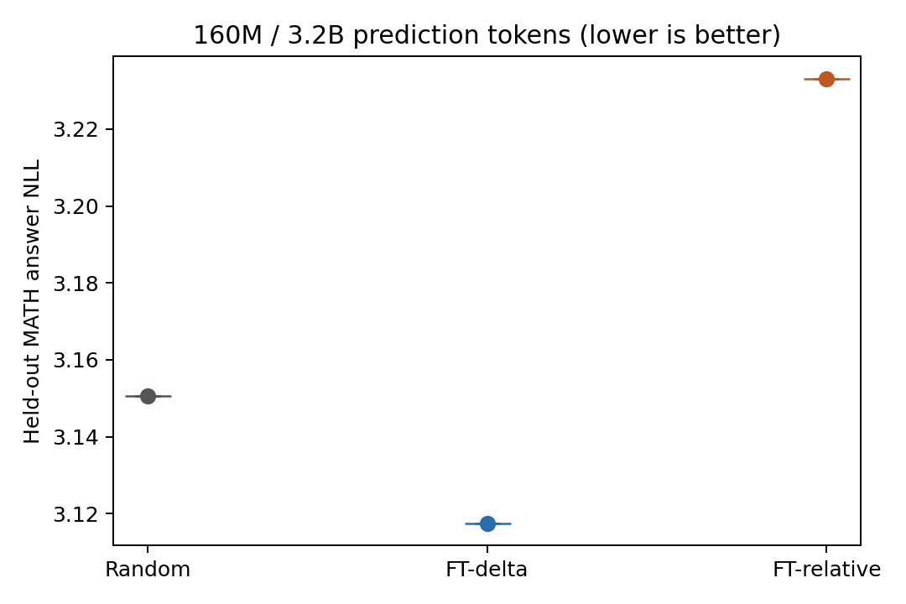
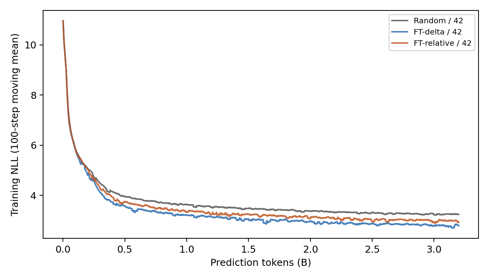

数学 loss-drop 选数实验：已完成 seeds [42]
============================================

每组从零预训练 160M，实际消耗 3,200,000,000 个有效预测 tokens。最终数学评估 4,061 道题。

| 实验组 | seed | 数学 NLL | 相对 Random 绝对改善 | 相对改善 | 规范化答案准确率 | 通用 NLL |
| --- | ---: | ---: | ---: | ---: | ---: | ---: |
| Random | 42 | 3.150628 | +0.000000 | +0.000% | 0.000% | 3.269054 |
| FT-delta | 42 | 3.117459 | +0.033169 | +1.190% | 0.025% | 3.366376 |
| FT-relative | 42 | 3.233151 | -0.082523 | -2.615% | 0.049% | 3.325799 |

正的改善值表示选数方法优于同 seed 的 Random。相对改善先逐题计算，再对题目和 seeds 平均。

| 方法 | 绝对改善均值及 95% CI | 相对改善均值及 95% CI |
| --- | --- | --- |
| FT-delta | +0.033169 [+0.028880, +0.037340] | +1.190% [+1.051%, +1.331%] |
| FT-relative | -0.082523 [-0.086570, -0.078520] | -2.615% [-2.743%, -2.488%] |

只有一个 seed 时，区间仅描述给定模型下的题目不确定性；多个 seeds 时同时重采样 seed 和题组。
生成评估使用固定的答案提取、LaTeX 字符串规范化与精确有理数等价；不包含通用符号推理判题，不能直接与其他 MATH leaderboard 准确率混比。
三个训练集的分布不同，训练 loss 曲线用于诊断，主要效果比较使用独立留出数学 NLL。

逐运行结果见 [metrics.csv](metrics.csv)，完整数值、分类器留出指标及数据统计见 [metrics.json](metrics.json)。
持久化运行产物：`/mnt/tianzhu_hot/data-picking-v2/runs/math-lossdrop-fasttext-qwen15b-pythia160m-n100000-seed20261102`。
